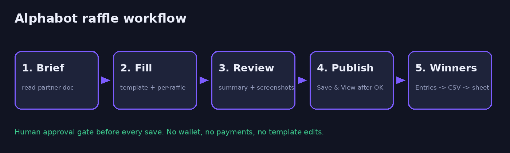
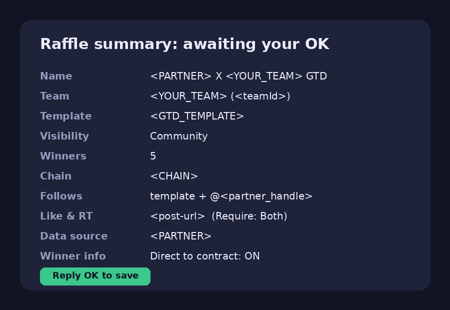
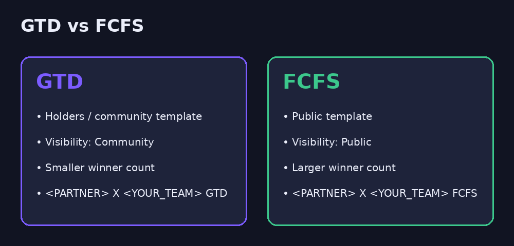
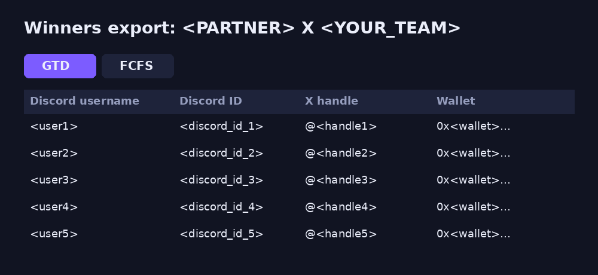

# Alphabot Raffle Skills

**Turn a partner brief into ready-to-publish Alphabot collab raffles in minutes, and pull winners into a spreadsheet without copy-pasting.**

An Agent Skills (`SKILL.md`) pack for AI agents with a browser tool (Hermes Agent, Claude-style agents, and others) that manage NFT/web3 community raffles on [Alphabot](https://www.alphabot.app).



## Features
- 📄 **Brief → raffle**: reads a partner doc and pulls out follows, Like & RT post, chain, winners, deadline
- 🧩 **Template-first**: uses your team's existing GTD (holders) and FCFS (public) templates and fills only per-raffle fields
- 🏷️ **Consistent naming**: `PARTNER X TEAM GTD` / `PARTNER X TEAM FCFS`
- ✅ **Human-in-the-loop**: summary + screenshots before every save
- 🏆 **Winner export**: Entries → CSV → spreadsheet with GTD/FCFS tabs
- ⏰ **Optional hourly auto-pull** of finalized winners

## Requirements
- An agent that loads Agent Skills `SKILL.md` files and has a **browser tool**
- A browser session **signed in to Alphabot** as a manager of your team (a separate email that belongs to your team is recommended)
- At least one raffle template per team (GTD and FCFS)
- Optional: a spreadsheet connector (e.g. Google Sheets/Drive)

## Install
Copy the skill folders into your agent's skills directory:
```bash
git clone https://github.com/ahmadaryanto/alphabot-raffle-skills
```
Then copy the `skills/` folders into your agent's skills directory (see your agent's docs).

Then start a conversation. The `alphabot-getting-started` skill collects your teams, `<teamId>`s and templates.

## Usage
```
Set me up for Alphabot raffles.
Create GTD (5 winners) and FCFS (25 winners) raffles for <YOUR_TEAM> from this brief: <doc-url>
Use the partner's chain from the doc and show me the summary before saving.
Pull winners for <PARTNER> X <YOUR_TEAM> GTD and FCFS into a sheet.
Every hour, pull winners from my finished raffles.
```



## Safety rules (built into the skills)
- Never connects a wallet, pays, buys boosts, or changes templates
- Never presses Enter in form fields (Alphabot submits on Enter)
- Always shows a summary + screenshots and waits for your OK before saving
- If *Save & View* leaves a draft, clicks it again and verifies
- Pulls winners only from raffles you created; never re-rolls or deletes winners
- Never types your credentials

## Gotchas
- Picking the Project data source can switch Blockchain (e.g. to Ethereum); after choosing the project, set the chain back to the correct one.
- Templates often leave *Type* blank, so the agent sets it to *Raffle*.

## Screenshots
| | |
|---|---|
|  |  |
|  |  |

*Illustrative mockups with placeholder values.*

## License
MIT. See [LICENSE](LICENSE). Not affiliated with Alphabot. Use responsibly and follow Alphabot's terms.
